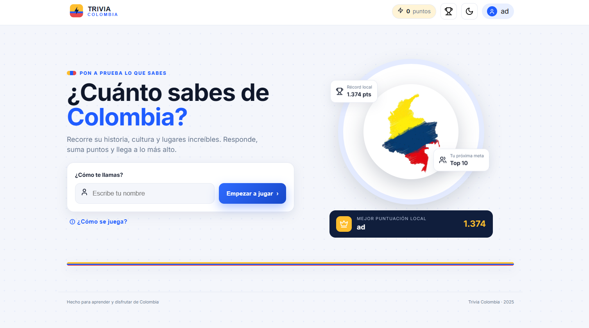

# Trivia Colombia

##Estudiante: Angel David Infante Espinel - 01220371056

Juego web de preguntas sobre Colombia: 10 preguntas por partida, 20 segundos
por pregunta, 5 categorías, 3 dificultades, comodines, rachas, ranking local
y estadísticas. Fiel a los diseños Figma aprobados y a los wireframes MockFlow.

**Juego en línea:** https://trivia-colombia-eight.vercel.app/
**Prototipo Figma:** https://www.figma.com/make/dtbKMg1NeM5ctTYJnAN7hk/High-Fidelity-UI-UX-Design?t=ETDDTfi4wFthykDd-1

## Vista previa



## Objetivo académico

Parcial de **Desarrollo Full Stack**: transformar los diseños en una aplicación
real, funcional, responsive y desplegable, con HTML5 + CSS3 + JavaScript ES6+
nativo, sin frameworks y sin backend.

## Tecnologías

- HTML5, CSS3, JavaScript ES6+ (módulos nativos, sin build).
- `localStorage` para persistencia (ranking, historial, récord, perfil, tema, sonido).
- Git + GitHub (control de versiones) y Vercel (despliegue estático).
- SVG para iconos; fuente Inter con fallback del sistema (usable sin conexión).
- Nada de React/Vue/Angular, Tailwind/Bootstrap, TypeScript, backend ni APIs.

## Funcionalidades

- **Inicio**: nombre obligatorio validado (no vacío/espacios), mejor puntuación local.
- **Instrucciones**: reglas, puntuación, comodines y consejo de racha.
- **Configuración**: 5 categorías (o multiselección, o todas) + dificultad
  Fácil/Medio/Difícil, con resumen y conteo real de preguntas disponibles.
  Interruptor de sonido con preferencia persistente.
- **Juego**: 10 preguntas sin repetición, progreso, timer de 20 s con aviso,
  4 opciones (clic o teclas 1-4/A-D), puntos, racha, 50/50 y +10 s
  (1 uso por partida, −30 c/u). Bloqueo anti-doble-respuesta y limpieza de timers.
- **Retroalimentación**: verde/roja con puntos, tu respuesta, la correcta y explicación.
- **Resultados**: total, aciertos/errores/no respondidas, % aciertos, tiempo real
  medido (mín. 1 s por respuesta), mejor categoría y repaso de falladas.
  Guardado único en ranking (sin duplicados).
- **Ranking y estadísticas**: top 10 local (puntos → tiempo → fecha), partidas,
  % global, desempeño por categoría (últimas 10) y dificultad, borrado en 2 pasos.
- **Perfil**: nombre e icono editables (10 insignias SVG), 5 puntajes recientes.
- **Sonido**: efectos Web Audio generados (sin archivos, funciona offline)
  al responder, usar comodines y terminar; se puede desactivar.
- **Tema** claro/oscuro persistente; responsive 360 px → escritorio; foco visible,
  navegación por teclado y mensajes no solo por color.

## Estructura

```
trivia-colombia/
├── index.html            # SPA: las 7 pantallas + modal de perfil
├── vercel.json           # despliegue estático (sin build)
├── README.md
├── css/
│   ├── styles.css        # tokens Figma, pantallas, modo oscuro
│   └── responsive.css    # breakpoints 1024/768/480 + timer sticky
├── js/
│   ├── app.js            # router SPA, partida, ranking, perfil (UI)
│   ├── ui.js             # navegación, toast, validación
│   ├── preguntas.js      # banco: 225 preguntas canónicas
│   ├── juego.js          # selección, racha, comodines, resumen (sin DOM)
│   ├── puntuacion.js     # ÚNICA función central de puntos (§7)
│   ├── temporizador.js   # 1 interval por pregunta, +10 s, tiempo real
│   ├── almacenamiento.js # ranking top-10, historial, récord (validado)
│   ├── estadisticas.js   # agregados puros (testeables)
│   ├── perfil.js         # nombre + icono local
│   ├── iconos.js         # iconografía SVG (interfaz + avatares)
│   └── sonido.js         # efectos Web Audio + preferencia persistente
├── assets/icons/logo.svg
├── tests/                # batería reproducible: node tests/run.mjs
│   ├── banco.mjs         # valida las 225 preguntas
│   ├── juego.mjs         # puntuación, selección, motor, timer (48)
│   ├── ranking.mjs       # orden, tope, estadísticas (16)
│   ├── tiempo.mjs        # tiempo real, fix 0:00 (4)
│   ├── perfil.mjs        # validaciones de perfil (8)
│   ├── sonido.mjs        # secuencias y degradación (8)
│   ├── estructura.mjs    # pantallas, categorías, niveles, top-10 (11)
│   └── run.mjs           # ejecuta toda la batería
└── docs/pruebas.md       # 20 casos §13 con resultados reales
```

## Ejecución local

Necesitas un servidor estático (los módulos ES no funcionan con `file://`):

```powershell
# opción 1: VS Code Live Server (clic derecho en index.html → Open with Live Server)
# opción 2:
npx serve .
# opción 3:
python -m http.server 8000
```

Abre `http://localhost:8000` (o el puerto indicado) y juega.

## Reglas de puntuación (§7)

`Puntos = max(0, [(100 + rapidez + racha) × multiplicador − penalización])`

| Concepto | Valor |
|---|---|
| Acierto base | +100 |
| Rapidez | +5 por segundo restante (máx. +100) |
| Racha (cada 3 seguidas) | +50 |
| Fallo / timeout | 0 (la penalización no resta del acumulado; `max(0,…)` evita negativos) |
| Comodín usado | −30 c/u |
| Fácil / Medio / Difícil | ×1 / ×1.5 / ×2 (siempre entero) |

## Almacenamiento local

Claves `tc_*_v1` en `localStorage` (nada sensible):

| Clave | Contenido |
|---|---|
| `tc_ranking_v1` | Top 10: nombre, puntos, categorías, dificultad, fecha ISO, aciertos/errores/sin responder, tiempo |
| `tc_historial_v1` | Últimas 100 partidas (base de estadísticas) |
| `tc_best_v1` | Récord `{ nombre, pts }` |
| `tc_perfil_v1` | `{ nombre, icono }` |
| `tc_theme_v1` | `light` / `dark` |
| `tc_sonido_v1` | `'1'` / `'0'` (defecto activado) |

Orden: puntos ↓, tiempo ↑, fecha reciente. Todo se valida al leer; ante datos
corruptos o storage bloqueado, el juego sigue funcionando sin persistencia.

## Despliegue

**Producción:** https://trivia-colombia-eight.vercel.app/ (Vercel, sin compilación).

Para republicar:

1. Sube el repo a GitHub (público).
2. En Vercel: *Add New → Project → Import* el repo.
3. Framework Preset: **Other** (o déjalo por defecto); no hay build command.
4. Deploy. `vercel.json` ya deja URLs limpias.

**GitHub** (cuando lo autorices):

```powershell
git add -A
git commit -m "feat: Trivia Colombia — parcial Full Stack"
git branch -M main
git remote add origin https://github.com/<usuario>/trivia-colombia.git
git push -u origin main
```

Sin secretos ni credenciales en el repo.

## Auditoría final (2026-10-13)

Revisión del código contra el enunciado, sin cambiar la identidad visual:

- **Sonido**: se añadió el control exigido en configuración (`js/sonido.js`,
  interruptor con `role="switch"`, preferencia `tc_sonido_v1`). Sin audio o sin
  storage, el juego sigue en silencio.
- **Penalización de comodines**: `calcularPuntos()` aplica ahora la fórmula en
  todos los caminos — incorrecta/timeout = 0 base y `max(0,…)` impide negativos
  incluso con penalización; el acumulado solo suma valores ≥ 0, así que el total
  nunca baja. 6 pruebas nuevas lo cubren.
- **Banco**: comentario de `js/preguntas.js` actualizado a la realidad
  (225 = 15 por combinación, IDs `-01…-15`).
- **Pruebas reproducibles**: los scripts vivían fuera del repo; ahora están en
  `tests/` con imports relativos (`node tests/run.mjs`). Nuevo
  `tests/estructura.mjs` que verifica 7 pantallas, 5+1 categorías, 3 niveles,
  10 preguntas, top-10 y banco ≥ 50.
- **Batería**: 95 asserts + validación del banco, todo en verde; sintaxis OK en
  los 11 módulos JS. Ver `docs/pruebas.md`.

## Limitaciones conocidas

- Ranking local por dispositivo (sin sincronización entre dispositivos).
- La partida en curso se pierde al recargar (no hay reanudación).
- Checklist de navegador de `docs/pruebas.md` (sección D) pendiente de ejecución
  manual: la lógica está verificada en Node (95 asserts + banco), falta el recorrido
  visual de 15-20 min.
- Sin modo sin conexión total: la fuente Inter usa Google Fonts con fallback.
